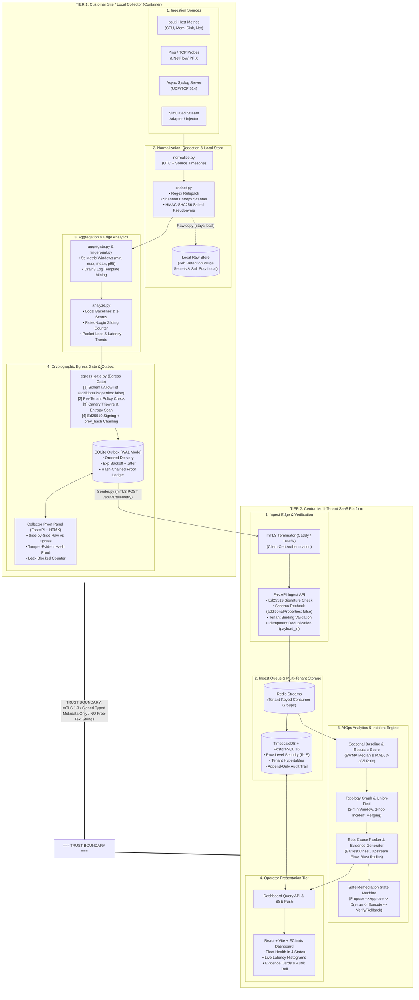

# VeilOps: Phase 1 — Problem Understanding, System Architecture & AIOps Strategy

**Role:** Person 3 (Product & AIOps Lead)  
**Hackathon:** CICADA 2026 (24-Hour Hackathon)  
**Track:** Secure AIOps Observability Solution  
**Phase Evaluation Weight:** Problem Understanding & Ideation (10 Marks)

---

## 1. Executive Summary

**VeilOps** is a two-tier, privacy-by-construction AIOps observability platform designed to solve the fundamental conflict between centralized operational intelligence and enterprise data confidentiality. 

Traditional observability systems require forwarding raw logs, host parameters, customer records, and network traces into a central SaaS or multi-tenant cloud. This paradigm continually results in secret leaks (API keys, JWTs, credentials), PII exposure, and severe regulatory/compliance violations (GDPR, HIPAA, SOC 2).

**The VeilOps Solution:**
- **Tier 1 (Local Customer Collector):** Deployed on-premises as a lightweight container. It collects raw system signals, scrubs secrets using Shannon entropy and strict regular expressions, hashes entity identities using a local HMAC-SHA256 salt, aggregates high-frequency metrics into 5-second windows, and mines log lines into structural template hashes (Drain3). Raw data, secrets, and salt **never cross the trust boundary**.
- **The Egress Gate:** A cryptographic gateway enforcing a strict typed JSON Schema (`additionalProperties: false`, no free-text fields). Outbound payloads contain only enums, numbers, hashes, and timestamps, and are scanned for canary secrets before being signed with an Ed25519 private key and recorded in a local hash-chained SQLite WAL ledger.
- **Tier 2 (Central Multi-Tenant SaaS):** Consumes signed metadata over mTLS, validating cryptographic signatures and schema integrity before enqueueing into Redis Streams. TimescaleDB stores time-series metadata under strict Row-Level Security (RLS). An advanced AIOps engine detects seasonal baseline anomalies (EWMA median + MAD robust z-scores), groups alerts using 2-hop topology union-find, ranks root causes via upstream graph traversal and onset chronology, and serves evidence-card recommendations with simulated, reversible remediation.

---

## 2. Mermaid Data-Flow Sketch with Trust Boundary

The system architecture divides strictly across a single authenticated trust boundary. Raw telemetry stays in Tier 1; only signed, schema-validated, metadata-only payloads enter Tier 2.



---

## 3. Four Core Use Cases

VeilOps translates complex raw telemetry into deterministic, privacy-preserving operational actions across four distinct production failure modes.

### Use Case 1: Infrastructure Health (CPU/Memory Baseline Deviation)
* **Signal:** 
  - Host metric stream reports `cpu_pct` rising from a normal seasonal median of $42.0\%$ to $94.5\%$ ($z = +6.8$) sustained over 4 consecutive 5-second windows.
  - Concurrently, log template miner observes template `tpl_a87f1c` ("Out of thread pool workers: pending queue size %d") surging by $28\times$.
  - Free memory drops below configured threshold ($< 8\%$).
* **Insight:**
  - Robust z-score exceeds 3.5 for $> 3$ consecutive evaluation windows, satisfying the sustained-deviation rule and excluding transient batch jobs.
  - Multi-signal correlation links process pool saturation with memory exhaustion on pseudonymous host `h_4af29c`.
* **Action:**
  - Egress payload updates collector health badge to **Fair** with reason code `CPU_BASELINE_DEV`.
  - SaaS AIOps engine generates Incident `INC-1041` with an Evidence Card suggesting thread-pool scale-up or application restart.

### Use Case 2: Network Latency and Packet Loss (Cascading Uplink Degradation)
* **Signal:**
  - Network probe signals on link `link_edge_sw2_uplink` report packet loss jumping from $0.05\%$ to $6.8\%$ ($z = +7.4$) at timestamp `09:14:48Z`.
  - Dependent downstream services (`api-gateway`, `orders-db`) report p95 latency jumping $+320\text{ ms}$ at `09:14:55Z`.
  - Downstream database connection error template count increases $30\times$ at `09:15:02Z`.
* **Insight:**
  - Alert-noise reduction groups 9 separate threshold breaches into a single incident based on topological proximity (within 2 hops) and temporal coincidence ($\Delta t < 2\text{ min}$).
  - Cause-ranking formula pinpoints `link_edge_sw2_uplink` as the root cause due to earliest onset ($09:14:48\text{Z}$) and topological upstream supremacy (explaining 8 of 9 downstream alerts).
* **Action:**
  - AIOps surfaces an Evidence Card with confidence score $0.82$, ruling out `orders-db` internal CPU exhaustion ($z = 0.4$).
  - Proposes automated remediation: failover upstream traffic to secondary link `link_edge_sw2_secondary`.

### Use Case 3: Repeated Failed Logins (Distributed Credential Stuffing / Auth Burst)
* **Signal:**
  - Syslog listener observes 85 failed login attempts in 60 seconds targeting auth endpoints.
  - Local collector scrubs raw usernames and passwords immediately, substituting source IP with salted pseudonym `p_77d1` and username with HMAC token.
  - Redaction rule blocks raw credentials; canary scanner confirms no raw strings exist in memory buffer.
* **Insight:**
  - Local security analyzer counts failure frequency per pseudonymous source within a 60-second sliding window.
  - Computes security risk index as `HIGH` due to velocity threshold breach ($> 40\text{ fails/min}$ from one entity).
  - Raw credentials, plaintext IP addresses, and user accounts **never reach the SaaS**.
* **Action:**
  - Collector transmits strictly typed metadata: `{"cat": "auth_fail", "src": "p_77d1", "count": 85, "win_s": 60, "risk": "high"}`.
  - SaaS raises security alert `SEC-0042` and recommends edge-firewall rate-limiting for pseudonym `p_77d1`.

### Use Case 4: Collector Fleet Health (Collector Offline / Stale Data Watchdog)
* **Signal:**
  - Collector `c_blr_dc1` emits regular 10-second heartbeats carrying queue depth, CPU/memory consumption, schema version, and config hash.
  - Network connectivity between customer datacenter and SaaS ingest edge is severed.
  - SaaS ingest receives no heartbeats or telemetry payloads for $> 15\text{ seconds}$, then $> 60\text{ seconds}$.
* **Insight:**
  - SaaS health-state engine tracks last-seen timestamp.
  - At $t = 15\text{ s}$ ($> 2$ missed heartbeats), status automatically downgrades from **Excellent** to **Fair** with reason code `STALE_DATA`.
  - At $t = 60\text{ s}$ (offline watchdog threshold), status drops to **Poor** with reason code `COLLECTOR_OFFLINE`.
  - Meanwhile, local collector buffers all signed records in SQLite WAL outbox with contiguous sequence numbers `seq: 88412, 88413, ...`.
* **Action:**
  - SaaS notifies on-call operator of collector disconnection.
  - Upon link restoration ($90\text{ s}$ later), collector outbox drains backlog in chronological order. SaaS processes payloads without gaps or duplicates (`zero loss, zero duplicates`).
  - Hysteresis rule ensures status transitions back to **Excellent** only after 3 consecutive successful heartbeats.

---

## 4. Prioritized Feature List & Minimum Viable Demo (MVD)

Using the **MoSCoW** prioritization framework, the project balances rapid hackathon delivery with enterprise-grade reliability and architectural depth.

```
+--------------------------------------------------------------------------------------------------+
|                                    PRIORITIZED FEATURE MATRIX                                    |
+--------------------------------------------------------------------------------------------------+
| MUST HAVE (Core Hackathon Foundation - Hours 0-12)                                               |
| • Egress Gate with strict JSON Schema (additionalProperties: false, no free-text strings).       |
| • End-to-end secret redaction (regex pack, Shannon entropy threshold, HMAC-SHA256 pseudonyms).   |
| • Drain3 log template miner (template hash + count).                                            |
| • Local SQLite outbox (WAL mode, ordered queue, exponential backoff, delete-after-ack).          |
| • Ingest API with Ed25519 signature verification & idempotent deduplication on payload_id.       |
| • TimescaleDB time-series storage with Postgres Row-Level Security (RLS) per tenant.             |
| • Four operational health states (Excellent, Good, Fair, Poor) with stale-data downgrade.        |
| • Streaming EWMA baseline & robust z-score anomaly detection engine.                             |
| • Mandatory Egress Proof Panel (FastAPI + HTMX / React) comparing local vs sent payload hashes.  |
+--------------------------------------------------------------------------------------------------+
| SHOULD HAVE (AIOps Intelligence & Global Reliability - Hours 12-18)                              |
| • NetworkX topology graph with 2-minute / 2-hop union-find incident correlation.                 |
| • Multi-factor root cause ranking (earliest onset, topological position, blast radius).         |
| • Structured Evidence Cards detailing contributing signals, robust z-scores, and reasons.        |
| • Server-Sent Events (SSE) live dashboard update stream.                                         |
| • Canary secret tripwire scanner with live blocked-leak alarm counters.                          |
| • Multi-region deployment configuration (ap-south, eu-central).                                  |
+--------------------------------------------------------------------------------------------------+
| COULD HAVE (Advanced Polish & Autonomous Operations - Hours 18-24)                              |
| • River Half-Space Trees joint multi-signal streaming model.                                      |
| • Reversible remediation state machine simulation with two-person approval & auto-rollback.       |
| • Live p50/p95/p99 collection-to-dashboard latency histogram panel.                               |
| • Automated scenario injector CLI for all 8 judge scenarios.                                    |
+--------------------------------------------------------------------------------------------------+
```

### Stated Minimum Viable Demo (MVD)
The Minimum Viable Demo consists of:
1. **One Local Collector Container:** Monitoring simulated system telemetry, scrubbing raw secrets, converting logs to Drain3 templates, and displaying outbound bytes on a local proof panel.
2. **Two Isolated Tenants:** `tenant_acme` (homed in `ap-south`) and `tenant_globex` (homed in `eu-central`), proving tenant isolation via RLS (tenant B query returns 0 rows for tenant A).
3. **One Ingest & AIOps Regional Cell:** Running FastAPI ingest, Redis Streams, TimescaleDB, and the Python AIOps baseline detector.
4. **Live Execution of the 8 Judge Scenarios:** Triggered deterministically via the scenario injector CLI:
   - *Scenario 1 (Secret Leak Attempt):* Injected canary key is blocked by Egress Gate; 0 leaks in SaaS.
   - *Scenario 2 (Collector Disconnect):* 90s outage triggers Poor state; reconnect replays outbox with 0 loss and 0 duplicates.
   - *Scenario 3 (Auth Failure Burst):* High-risk pseudonym alert generated without exposing raw usernames.
   - *Scenario 4 (Network Degradation):* Latency & packet loss spike highlighted on trend chart.
   - *Scenario 5 (CPU Deviation):* Baseline deviation flagged with robust z-score and contributing metrics.
   - *Scenario 6 (Uplink Cascade):* 9 individual alerts merged into 1 correlated incident with ranked cause.
   - *Scenario 7 (Duplicate/Out-of-Order Delivery):* Replayed payloads handled idempotently by `payload_id`.
   - *Scenario 8 (Remediation Simulation):* Recommended action undergoes policy check, approval, dry-run, and rollback demonstration.

---

## 5. Answers to Mandatory Phase 1 Questions

### Q1: What was the situation before observability?
> **Answer:**  
> Prior to implementing VeilOps, each site operated as an isolated operational silo relying on fragmented monitoring scripts, disparate vendor agents, and manual log searching (`grep`, `tail -f`). Static threshold alerts generated massive alert fatigue with hundreds of redundant, uncoordinated notifications for a single underlying fault. Crucially, obtaining any centralized visibility required shipping raw application and system logs across the public internet to a third-party SaaS. This exposed plaintext API keys, access tokens, database connection strings, and customer PII, repeatedly breaching data sovereignty mandates (GDPR, HIPAA, PCI-DSS) and introducing catastrophic exfiltration risks.

### Q2: What does the team now observe with the solution?
> **Answer:**  
> With VeilOps, the operations and security teams observe a unified, real-time, privacy-guaranteed view across all remote collectors and fleets. The system provides:
> 1. Collector and fleet operational health classified into four deterministic states (**Excellent**, **Good**, **Fair**, **Poor**) with explicit reason codes and automatic stale-data downgrades.
> 2. Fine-grained latency, packet loss, and resource saturation metrics tracked against dynamic, seasonal EWMA baselines rather than fragile static thresholds.
> 3. Salted pseudonymous security risk indicators that quantify authentication failure bursts and credential stuffing velocity without exfiltrating usernames or source IPs.
> 4. Topologically correlated incidents that merge cascading alert floods into single actionable items with ranked root causes and clear evidence cards.
> 5. A tamper-evident, hash-chained egress ledger backed by a local Egress Proof Panel, providing mathematical certainty that only sanitized, allow-listed metadata leaves customer premises.

---

## 6. Realistic 24-Hour Plan for Three People

| Time Interval | Person 1: Collector & Privacy Lead | Person 2: SaaS & Reliability Lead | Person 3: Product, AIOps & Demo Lead | Key Deliverables & Validation |
| :--- | :--- | :--- | :--- | :--- |
| **Hours 0–4** *(Phase 1: Setup & Foundations)* | Define wire schema (`contracts/`), build stream adapter & synthetic telemetry generator. | Setup Docker Compose stack (TimescaleDB, Redis, Caddy), configure base database schemas & RLS. | Author Phase 1 docs, Mermaid data flows, design baseline prototype & EWMA robust z-score engine. | **Checkpoint 1 (Hour 2):** Wire schema & data contract frozen in `contracts/`. Prototype tests pass. |
| **Hours 4–12** *(Phase 2: Core Engineering)* | Implement input plugins, regex/entropy redaction, Drain3 template miner, local failed-login tracker. | Build FastAPI Ingest API, Ed25519 signature checks, Redis Streams publisher, worker consumer queue. | Develop streaming seasonal baseline profile, NetworkX topology builder, and union-find alert grouping. | **Checkpoint 2 (Hour 8):** First telemetry payload flows from generator through Egress Gate to TimescaleDB. |
| **Hours 12–18** *(Phase 3: Integration & UX)* | Implement SQLite WAL outbox, hash-chained ledger, canary scanner, FastAPI/HTMX Proof Panel. | Implement health-state engine (4 states, hysteresis), Query API, SSE push, collector fleet overview. | Implement root-cause ranking, Evidence Card JSON engine, remediation state machine, incident UI. | **Checkpoint 3 (Hour 14):** All 8 judge scenarios triggerable via scenario injector; proof panel operational. |
| **Hours 18–24** *(Phase 4: Hardening & Demo)* | Execute canary leak test scripts, measure outbox buffer capacity under simulated 90s disconnect. | Run p50/p95/p99 latency benchmarks, verify duplicate replay idempotency, validate RLS cross-tenant isolation. | Tune false-alarm suppression, verify evidence card clarity, assemble 8-slide presentation deck & run rehearsals. | **Checkpoint 4 (Hour 20):** Complete feature freeze. Dry-run scenarios 1–8 with timer & recording backup. |

### Integration Checkpoints
1. **Hour 2:** Wire schema and policy schema frozen in `contracts/payload.schema.json`. Zero unilateral modifications permitted.
2. **Hour 8:** End-to-end pipe verified: Simulated metric $\rightarrow$ Collector Redaction $\rightarrow$ Egress Gate $\rightarrow$ Ingest API $\rightarrow$ TimescaleDB.
3. **Hour 14:** All 8 judge scenarios executable via injector CLI; basic UI renders incident and proof panel.
4. **Hour 20:** Strict feature freeze. The final 4 hours are reserved exclusively for benchmark verification, leak test validation, and live demo practice.

### Scope Cuts Contingency Plan (Strict Priority Order)
If time constraints emerge, features will be trimmed strictly in the following order to protect core judging points:
1. **Cut 1 (River Half-Space Trees):** Drop streaming HSTrees and rely on EWMA median + MAD robust z-score (which already provides accurate anomaly detection).
2. **Cut 2 (Secondary SaaS Region):** Keep two isolated tenants homed on a single regional cluster with full RLS validation instead of provisioning two distinct Docker clusters.
3. **Cut 3 (Hardware SNMP Inputs):** Drop live network SNMP interface polling and stream all host and network metrics through the synthetic telemetry generator.
4. **NON-NEGOTIABLE CORE (Never Cut):**
   - Cryptographic Egress Gate (`additionalProperties: false`, no free text)
   - Local Egress Proof Panel with verify button
   - SQLite WAL Outbox & reconnection replay
   - Evidence-Card AIOps with ranked causes and noise reduction

---

## 7. Bonus Architectural Capabilities in the MVD

### 1. Alert-Noise Reduction
- **Mechanism:** Alerts are tagged with a deduplication key `(component_id, category, severity)`. Recurring deviations within the active window increment an internal counter rather than generating distinct alert cards.
- **Topological Union-Find:** When cascading failures occur (e.g., edge switch degradation impacting database connections and API latency), alerts occurring within a 2-minute temporal window and within 2 graph hops are clustered into a single master Incident.
- **Flap Prevention:** An incident requires 5 consecutive minutes of normal telemetry before transitioning to `CLOSED`.
- **MVD Demonstration:** Scenario 6 injects an uplink fault triggering 9 individual raw threshold breaches; the dashboard UI displays:  
  `"Noise Reduction: 9 raw alerts merged into 1 incident (88.9% alert noise eliminated)"`.

### 2. Explainable AIOps Recommendations (Evidence Cards)
- Rather than presenting black-box AI scores or generic text summaries, VeilOps formats every diagnostic insight as an inspectable **Evidence Card**:
  - **Exact Contributing Signals:** Metric names, observed values, seasonal baselines, and statistical deviations (e.g., `packet_loss: 6.4%, z = +7.1, onset: 09:14:48Z`).
  - **Chronological Precedence:** Highlights which component failed first (causes precede effects).
  - **Topological Position:** Demonstrates why an upstream switch explains downstream service errors.
  - **Counter-Factual Proof (Why Not Alternatives):** Explicitly notes which alternative candidate components were evaluated and rejected (e.g., `"orders-db CPU within normal baseline: z = +0.4"`).
  - **Mathematical Confidence:** Calibrated confidence percentage based on signal coherence and graph distance.

### 3. Safe Remediation Simulation
- **Zero Cloud Credentials:** The SaaS never holds SSH keys, cloud credentials, or access tokens for customer infrastructure. It emits only a cryptographically signed action identifier (`action_id: ACT-8821`).
- **Policy Enforcement:** The local collector verifies that the requested action is permitted by local tenant policy and within the scheduled change window.
- **Two-Person Human-in-the-Loop Approval:** High-risk actions (e.g., traffic failover, service restart) require two administrator approvals in the dashboard.
- **Automated Verification & Rollback:** 
  1. The collector adapter executes a dry-run test, capturing pre-execution metric snapshots.
  2. Executes the simulated action on a mock container target.
  3. Enters a 2-minute verification watch. If target metrics do not recover or deteriorate further, the collector automatically executes the rollback procedure and logs the entire lifecycle to an immutable, append-only audit trail.

---

## 8. Cross-Team Technical Alignment Summary

To ensure seamless integration across Person 1, Person 2, and Person 3 during Phase 2:

| Aspect | Person 1 (Collector / Privacy) | Person 2 (SaaS / Reliability) | Person 3 (AIOps / Demo) |
| :--- | :--- | :--- | :--- |
| **Data Contract** | Produces `contracts/payload.schema.json` & outbound serialization. | Validates schema on Ingest API with `additionalProperties: false`. | Consumes validated metadata stream from Redis Streams. |
| **Identity & Security** | Applies local HMAC salt; signs payload with Ed25519 collector key. | Verifies Ed25519 signature & binds `tenant_id` to mTLS certificate. | Maps pseudonymous nodes in NetworkX topology graph. |
| **Reliability** | Buffers outbound records in SQLite WAL outbox; tracks `seq`. | Tracks contiguous `seq`; detects gaps and ignores replayed duplicate `payload_id`. | Uses event-time windowing with 2-minute watermark to process late arrivals. |
| **UI Experience** | Hosts local FastAPI + HTMX Proof Panel on collector port 8081. | Hosts React SaaS Dashboard on port 3000 with SSE real-time stream. | Renders interactive Evidence Cards, topology graph, and remediation workflow. |
