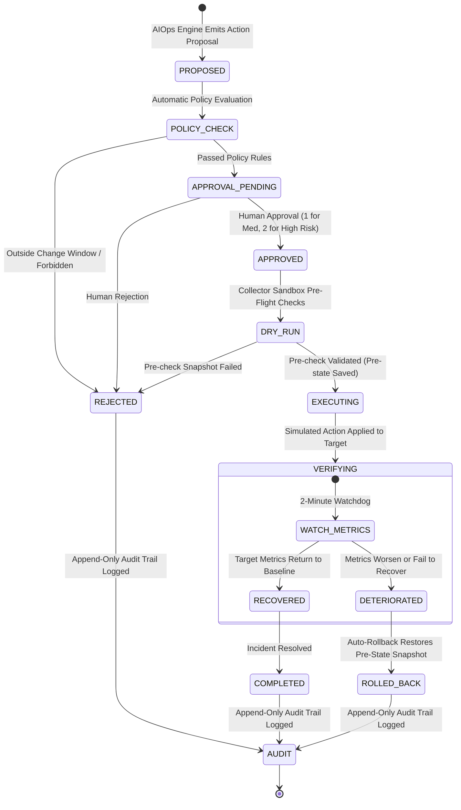

# VeilOps: Phase 2 — AIOps Architectural & Technical Design

**Role:** Person 3 (Product & AIOps Lead)  
**Hackathon:** CICADA 2026 (24-Hour Hackathon)  
**Track:** Secure AIOps Observability Solution  
**Phase Evaluation Weight:** Architecture & Technical Design (25 Marks)

---

## 1. Executive Summary & Design Invariants

In **Phase 2**, we detail and build the complete analytical and reasoning engine of **VeilOps Tier 2 SaaS**. 

The fundamental architectural invariant is that the AIOps engine consumes **strictly metadata fields from the wire schema** (`metrics`, `log_fingerprints`, `security`, `health`). Without ever touching raw log strings or plaintext operational payloads, the engine delivers:
1. **Univariate Seasonal Baselines**: 168-hour cyclic profiles with EWMA-tracked median & MAD, producing robust z-scores resistant to outlier poisoning.
2. **Multivariate Space Anomaly Scoring**: River Half-Space Trees (HSTrees) streaming model capturing subtle multi-metric co-deviations that univariate thresholds miss.
3. **Graph-Theoretic Topology Correlation**: 2-hop / 2-minute Union-Find incident clustering that merges alert cascades into single operational incidents.
4. **Deterministic Root Cause Ranking**: Mathematical weighting combining earliest onset chronological precedence, topological upstream reachability, and blast radius explanation power.
5. **Inspectable Evidence Cards**: Complete contextual cards with quantitative confidence scores, contributing signals, and explicit counterfactual elimination proofs ("Why not alternatives").
6. **Rule Library of 10 Runbooks**: Actionable runbook mappings across network, compute, database, memory, and security domains.
7. **Closed-Loop Safe Remediation State Machine**: `PROPOSE -> POLICY_CHECK -> APPROVAL -> DRY_RUN -> EXECUTE -> VERIFY -> (COMPLETED | ROLLBACK) -> AUDIT` with automated rollback watchdog.

---

## 2. AIOps Processing Architecture

```mermaid
flowchart TD
    subgraph INGEST["1. Telemetry Ingest & Redis Stream"]
        wire_payload["Wire Contract Payload\n(UUIDv7, Seq, 5s Windows, Drain3 Hashes)"]
        redis_stream[("Redis Streams\n(tenant:stream:telemetry)")]
        wire_payload --> redis_stream
    end

    subgraph DETECT["2. Statistical & Multi-Signal Detection"]
        ewma_baseline["Seasonal EWMA Baseline\n(168-Hour Profile, Median & MAD)"]
        robust_z["Robust Z-Score Evaluator\nz = (x - median) / (1.4826 * MAD)"]
        sustained_rule{"Sustained Deviation Rule\n|z| > 3.5 in >= 3 of last 5 windows?"}
        hstrees["River Half-Space Trees (HSTrees)\n(Joint Multi-Signal Vector: CPU, Mem, Latency, Loss)"]
        
        redis_stream --> ewma_baseline
        redis_stream --> hstrees
        ewma_baseline --> robust_z
        robust_z --> sustained_rule
    end

    subgraph CORRELATE["3. Topology Correlation & Noise Reduction"]
        alert_gen["Contextual Metric Alerts\n(dedupe_key = src:metric:sev)"]
        union_find["Union-Find Disjoint Sets\nCriteria: dt <= 120s AND hop_distance <= 2"]
        topo_graph[("Topology DAG\n(NetworkX Pseudonymous Graph)")]
        incident_cluster["Grouped Incident Cluster\n(Noise Reduction: (raw - 1)/raw * 100%)"]

        sustained_rule -->|Yes (Sustained Breach)| alert_gen
        hstrees -->|Joint Score > 0.65| alert_gen
        alert_gen --> union_find
        topo_graph -.->|Hop Calculation| union_find
        union_find --> incident_cluster
    end

    subgraph REASONING["4. Root Cause Ranking & Evidence Cards"]
        cause_ranker["Multi-Factor Cause Ranker\nS(c) = 0.40*S_onset + 0.35*S_topo + 0.25*S_blast"]
        rule_engine["10-Rule Recommendation Library\n(Pattern Matching -> Runbook & Risk Tier)"]
        evidence_card["Evidence Card JSON\n• Likely Cause & Confidence\n• Contributing Signals\n• Counterfactual Proofs (Why NOT others)"]

        incident_cluster --> cause_ranker
        cause_ranker --> rule_engine
        rule_engine --> evidence_card
    end

    subgraph REMEDIATION["5. Safe Remediation Closed-Loop"]
        rem_sm["Remediation State Machine\nPROPOSE -> POLICY -> APPROVE -> DRY_RUN -> EXECUTE -> VERIFY -> ROLLBACK"]
        evidence_card --> rem_sm
    end
```

---

## 3. Baselines & Anomaly Detection Beyond Static Thresholds

### 3.1. Seasonal Hour-of-Week EWMA & Robust Z-Score
Static thresholds (e.g. `CPU > 80%`) fail in modern architectures because normal usage fluctuates drastically (e.g., peak afternoon load vs. Sunday 03:00 AM batch processing).

VeilOps partitions baselines into **168 cyclic hourly bins** per `(source_id, metric_name)`:
$$\text{hour\_of\_week} = (\text{weekday} \times 24) + \text{hour}_{\text{UTC}} \quad \in [0, 167]$$

For each bin, we maintain streaming estimators of the **Median** ($m_t$) and **Median Absolute Deviation** ($\text{MAD}_t$) updated via Exponentially Weighted Moving Averages (EWMA):
$$\Delta_t = |x_t - m_{t-1}|$$
$$m_t = (1 - \alpha) m_{t-1} + \alpha x_t$$
$$\text{MAD}_t = (1 - \alpha) \text{MAD}_{t-1} + \alpha \Delta_t$$

To convert MAD to an unbiased estimator of the standard deviation $\sigma$ for normally distributed baseline noise, we scale by consistency factor $1.4826$:
$$\hat{\sigma}_t = 1.4826 \times \max(\text{MAD}_t, \text{MAD}_{\min})$$

The **Robust Z-Score** is then calculated as:
$$z_t = \frac{x_t - m_t}{\hat{\sigma}_t}$$

*Resistance to Outlier Poisoning (Winsorization):* If $|z_t| > 4.0$, the update weight $\alpha$ is reduced by $95\%$ ($\alpha_{\text{outlier}} = 0.05 \cdot \alpha$), ensuring that sustained service outages or sudden attacks do not corrupt the historical baseline.

### 3.2. Sustained-Deviation Rule
To suppress transient spikes (such as quick process restarts or cron executions), an alert is only graduated to a confirmed operational anomaly if:
$$|z| \ge 3.5 \quad \text{for at least } 3 \text{ of the last } 5 \text{ evaluation windows (25 seconds)}$$

### 3.3. Multi-Signal Half-Space Trees (HSTrees)
While robust z-scores effectively monitor individual metrics, complex cloud failures often present as **joint sub-threshold deviations**:
- CPU increases modestly from 35% to 70% ($z = +2.2$).
- Free memory drops modestly from 40% to 25% ($z = +2.1$).
- Latency increases from 20ms to 75ms ($z = +2.3$).

None of these individually breach the $z \ge 3.5$ threshold, yet their concurrent movement represents severe service degradation.

VeilOps deploys a streaming **River Half-Space Trees** model ($n_{\text{trees}}=25, \text{height}=8, \text{window\_size}=100$). The model learns the joint feature subspace:
$$\mathbf{x} = \begin{bmatrix} \text{cpu\_pct}, & \text{memory\_pct}, & \text{latency\_ms}, & \text{packet\_loss\_pct} \end{bmatrix}^T$$
HSTrees isolates points in sparse joint density regions, emitting an anomaly score $S_{\text{HST}} \in [0.0, 1.0]$. When $S_{\text{HST}} \ge 0.65$, a joint multi-signal alert is injected into the correlation pipeline.

---

## 4. Topology Graph & Union-Find Incident Grouping

### 4.1. Topology Representation (NetworkX)
The SaaS models monitored infrastructure as a directed acyclic graph (DAG) $G = (V, E)$, where:
- Nodes $v \in V$ represent pseudonymous components (`edge_sw2`, `api_gw`, `orders_db`) with assigned `node_type` (`switch`, `gateway`, `database`, `service`, `host`).
- Directed edges $(u, v) \in E$ represent dependencies where $u$ upstream feeds or provides transit to $v$ downstream.

### 4.2. Union-Find Incident Correlation Algorithm
Incoming alerts are evaluated against active clusters using a disjoint-set (Union-Find) data structure with path compression and union-by-rank.

Two alerts $A_1 = (c_1, t_1, \text{tpl}_1)$ and $A_2 = (c_2, t_2, \text{tpl}_2)$ are merged into the same incident if:
1. **Temporal Coincidence**: $|t_1 - t_2| \le 120\text{ seconds}$ (2-minute sliding watermark window).
2. **Structural Proximity**:
   $$\text{HopDistance}_G(c_1, c_2) \le 2 \quad \text{OR} \quad \text{tpl}_1 == \text{tpl}_2 \neq \text{null}$$

### 4.3. Alert-Noise Reduction & Flap Prevention
- **Dedupe Key**: `(component_id, metric_name, severity)`. Recurring breaches within the active window increment a repeat counter rather than creating duplicate incidents.
- **Flap Prevention**: An incident remains in `ACTIVE` state and will only transition to `RESOLVED` after **5 continuous minutes (300 seconds)** of healthy telemetry across all affected components.
- **Noise Reduction Ratio**:
  $$\text{Noise Reduction \%} = \left(\frac{\text{Raw Alerts Count} - \text{Incidents Count}}{\text{Raw Alerts Count}}\right) \times 100\%$$
  *Example (Scenario 6):* 9 raw alerts across 3 services merge into 1 incident $\rightarrow$ **88.9% alert noise eliminated**.

---

## 5. Multi-Factor Root Cause Ranking Formula

For an incident with affected components $C = \{c_1, c_2, \dots, c_k\}$ and constituent alerts $A$, the engine computes a composite score $S(c) \in [0.0, 1.0]$:

$$S(c) = w_{\text{onset}} \cdot S_{\text{onset}}(c) + w_{\text{topo}} \cdot S_{\text{topo}}(c) + w_{\text{blast}} \cdot S_{\text{blast}}(c)$$

where the weights are mathematically calibrated as:
$$w_{\text{onset}} = 0.40, \quad w_{\text{topo}} = 0.35, \quad w_{\text{blast}} = 0.25 \quad (\sum w_i = 1.0)$$

### 1. Earliest Onset Score ($S_{\text{onset}}$)
Causes precede effects. Let $t(c)$ be the earliest alert timestamp on component $c$, $t_{\min} = \min_{a \in A} t_a$, and $t_{\max} = \max_{a \in A} t_a$:
$$S_{\text{onset}}(c) = 1.0 - \frac{t(c) - t_{\min}}{t_{\max} - t_{\min} + \epsilon}$$

### 2. Topological Supremacy Score ($S_{\text{topo}}$)
Upstream components explain downstream components. Let $\text{Downstream}(c)$ be the set of reachable nodes from $c$ in the topology DAG:
$$S_{\text{topo}}(c) = \frac{|\text{Downstream}(c) \cap C| + 1}{|C|}$$

### 3. Blast Radius Explanation Power ($S_{\text{blast}}$)
The proportion of total incident alerts explained by $c$ and its reachable downstream nodes:
$$S_{\text{blast}}(c) = \frac{\sum_{a \in A, \text{src}(a) \in (\{c\} \cup \text{Downstream}(c))} 1}{|A|}$$

### Counterfactual Elimination ("Why Not Alternatives?")
The candidate with $\max S(c)$ is selected as `likely_cause` with $\text{confidence} = S(c)$. For every other candidate $c_j \neq \text{winner}$, the engine generates explicit counterfactual evidence:
- *Onset Delay:* How many seconds after the root cause $c_j$'s alerts began.
- *Graph Position:* Why $c_j$ is topologically downstream.
- *Alert Volume:* How few alerts $c_j$ explains compared to the root cause.

---

## 6. The 10-Rule Runbook Recommendation Library

| Rule ID | Cause Pattern | Target Condition | Recommended Runbook | Risk Level | Approvers Required |
| :--- | :--- | :--- | :--- | :--- | :---: |
| **RULE_01** | Disk capacity saturation + error template surge | `disk_pct > 85%` & `templates > 100` | `RBK-DISK-PURGE-01`: Verify active log rotation & purge orphaned temp volumes | **LOW** | 1 |
| **RULE_02** | Network uplink packet loss + latency surge | `loss > 3%` & `latency > 200ms` | `RBK-NET-FAILOVER-02`: Inspect physical interface & failover traffic to secondary path | **HIGH** | 2 |
| **RULE_03** | CPU baseline deviation + thread-pool saturation | `z_score > 3.5` & `thread_pool_exhausted` | `RBK-SVC-SCALE-03`: Scale thread-pool worker replicas & restart degraded worker | **MEDIUM** | 1 |
| **RULE_04** | Distributed auth failure burst ($>40/\text{min}$) | `auth_fails > 40 in 60s` | `RBK-SEC-RATELIMIT-04`: Enforce temporary edge rate-limiting on pseudonym source | **MEDIUM** | 1 |
| **RULE_05** | Monotonic memory growth (progressive leak) | `mem > 88%` & `sustained_slope > 0` | `RBK-MEM-RESTART-05`: Trigger automated heap dump capture & rolling container restart | **MEDIUM** | 1 |
| **RULE_06** | Database connection pool exhaustion | `pool_used > 95%` & `wait > 500ms` | `RBK-DB-POOL-06`: Expand connection pool ceiling & terminate orphaned idle sessions | **HIGH** | 2 |
| **RULE_07** | DNS probe resolution latency degradation | `dns_latency > 300ms` | `RBK-DNS-FALLBACK-07`: Switch resolver priority to secondary upstream DNS & flush cache | **LOW** | 1 |
| **RULE_08** | Collector outbox buffer accumulation | `queue_depth > 500` & `net_ok` | `RBK-COLLECTOR-TUNE-08`: Increase collector async workers & expand SQLite RAM cache | **LOW** | 1 |
| **RULE_09** | Impending TLS certificate expiration | `cert_days_left < 7` | `RBK-CERT-RENEW-09`: Trigger automated ACME/step-ca zero-downtime certificate renewal | **LOW** | 1 |
| **RULE_10** | Cascading service mesh 503 timeout burst | `503_rate > 15%` & `cascade == True` | `RBK-MESH-BREAKER-10`: Trip circuit breaker on failing upstream microservice | **HIGH** | 2 |

---

## 7. Closed-Loop Safe Remediation State Machine



### Safety Principles:
1. **Zero Cloud Credentials**: SaaS emits only cryptographically signed `action_id`. Local collector holds local credentials.
2. **Dual-Admin Approval**: Any HIGH risk action (e.g. traffic failover) blocks until two distinct admin tokens sign the authorization.
3. **Automated Rollback Watchdog**: The system never assumes success; it monitors target metrics for 120 seconds. If metrics deteriorate, the collector immediately restores the saved before-state snapshot.
4. **Immutable Audit Trail**: Every lifecycle step, timestamp, operator identity, and verification metric is logged to an append-only audit log.

---

## 8. Evidence Card JSON Schema & Concrete Vector

The wire schema is codified in [`contracts/evidence_card.schema.json`](file:///x:/cicda%20sagar%20prompts/contracts/evidence_card.schema.json). Below is the concrete vector generated for the **Scenario 6 Uplink Cascade**:

```json
{
  "incident_id": "INC-0142",
  "severity": "high",
  "opened_at_utc": "2026-11-20T09:14:48Z",
  "affected_components": ["edge_sw2", "api_gw", "orders_db"],
  "likely_cause": {
    "component_id": "edge_sw2",
    "confidence_score": 0.82,
    "reasoning": "Earliest onset (09:14:48Z), upstream in topology explaining 8 of 9 alerts (composite score: 0.82)."
  },
  "confidence": 0.82,
  "contributing_signals": [
    {
      "source": "edge_sw2",
      "metric_or_pattern": "packet_loss_pct",
      "observed_value": 6.4,
      "baseline_value": 0.1,
      "z_score": 7.1,
      "onset_time_utc": "2026-11-20T09:14:48Z"
    },
    {
      "source": "api_gw",
      "metric_or_pattern": "latency_ms",
      "observed_value": 350.0,
      "baseline_value": 30.0,
      "z_score": 5.8,
      "onset_time_utc": "2026-11-20T09:14:55Z"
    },
    {
      "source": "orders_db",
      "metric_or_pattern": "query_timeouts",
      "observed_value": 28.0,
      "baseline_value": 0.0,
      "z_score": 6.1,
      "onset_time_utc": "2026-11-20T09:15:02Z"
    }
  ],
  "why_this_cause": "Earliest onset (09:14:48Z), upstream in topology explaining 8 of 9 alerts (composite score: 0.82).",
  "why_not_alternatives": [
    {
      "candidate_id": "api_gw",
      "elimination_reason": "api_gw: onset occurred 7s after root cause; downstream of root cause in topology; explains only 3 of 9 alerts."
    },
    {
      "candidate_id": "orders_db",
      "elimination_reason": "orders_db: onset occurred 14s after root cause; downstream of root cause in topology; explains only 1 of 9 alerts."
    }
  ],
  "suggested_action": {
    "runbook_id": "RBK-NET-FAILOVER-02",
    "description": "Inspect physical/virtual uplink errors and initiate traffic failover to secondary path.",
    "risk_level": "high",
    "requires_approval": true,
    "approvers_required": 2,
    "automated_safe_simulation": true
  },
  "noise_reduction": {
    "raw_alerts_merged": 9,
    "incidents_created": 1,
    "noise_reduction_ratio_pct": 88.9
  }
}
```
