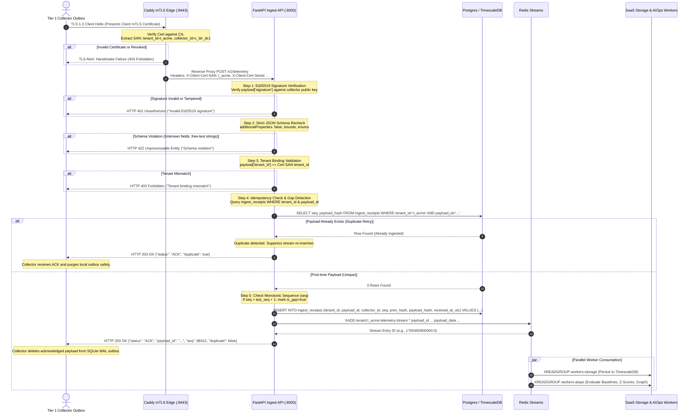

# VeilOps: Phase 2 — Tier 2 SaaS Architecture, Data Engine & Reliability Technical Design

**Role:** Person 2 (SaaS and Reliability Architect)  
**Hackathon:** CICADA 2026 (24-Hour Hackathon)  
**Track:** Secure AIOps Observability Solution  
**Phase Evaluation Weight:** Architecture & Technical Design (25 Marks)

---

## 1. End-to-End System Architecture (Every Network Hop & Trust Boundary Labeled)

The VeilOps architecture is split strictly across a single, cryptographically enforced trust boundary. Raw telemetry, customer credentials, packet payloads, and HMAC salts remain strictly in the customer tier (Tier 1). Only signed, schema-validated metadata payloads cross into Tier 2.

```mermaid
flowchart TD
    %% Styling
    classDef t1 fill:#e8f4fd,stroke:#2b6cb0,stroke-width:2px,color:#1a365d;
    classDef t2 fill:#edf2f7,stroke:#4a5568,stroke-width:2px,color:#2d3748;
    classDef tb fill:#fed7d7,stroke:#9b2c2c,stroke-width:3px,stroke-dasharray: 5 5,color:#742a2a;
    classDef bus fill:#feebc8,stroke:#c05621,stroke-width:2px,color:#7b341e;
    classDef db fill:#e6fffa,stroke:#234e52,stroke-width:2px,color:#1d4044;

    subgraph TIER1["TIER 1: Customer On-Premises Environment (Local Collector)"]
        direction TB
        c_inputs["Telemetry Sources\n(psutil, Probes, Syslog 514, Stream Adapter)"]:::t1
        c_proc["Normalize & Redact\n(UTC+source_tz, Shannon Entropy, HMAC Salt)"]:::t1
        c_store[("Local Store: Raw Logs\n(24h Purge, Secrets Stay Local)")]:::t1
        c_agg["Window Aggregation & Mining\n(5s Tumbling Windows, Drain3 Templates)"]:::t1
        c_gate["Egress Gate (Security Enforcement)\n1. JSON Schema (additionalProperties: false)\n2. Tenant YAML Policy Validation\n3. Canary Tripwire & Entropy Scan\n4. Ed25519 Signature + prev_hash Chaining"]:::t1
        c_outbox[("SQLite Outbox (WAL Mode)\nOrdered Drain, Exp Backoff + Jitter\nTamper-Evident Ledger")]:::t1
        c_panel["Egress Proof Panel (Local HTMX/FastAPI)\nSide-by-Side Raw vs Sent | Hash Match"]:::t1

        c_inputs -->|Hop 1: IPC / Local Loopback| c_proc
        c_proc -.->|Hop 2: Local Raw Copy| c_store
        c_proc -->|Hop 3: In-Memory Pipeline| c_agg
        c_agg -->|Hop 4: In-Memory Pipeline| c_gate
        c_gate -->|Hop 5: Atomic SQLite WAL Write| c_outbox
        c_outbox <-->|Hop 6: Local Read/Verify| c_panel
    end

    %% The Trust Boundary
    TRUST_BOUNDARY{"=== TRUST BOUNDARY ===\nmTLS 1.3 | Client Cert Auth | Signed Metadata Only | ZERO Free-Text"}:::tb
    
    c_outbox -->|Hop 7: HTTPS / mTLS 1.3 Egress POST /v1/telemetry| TRUST_BOUNDARY

    subgraph TIER2["TIER 2: Central Multi-Tenant SaaS Platform (Regional Cells)"]
        direction TB
        
        subgraph REGION_INGEST["Regional Ingestion Cell (e.g., ap-south / eu-central)"]
            s_caddy["mTLS Terminator (Caddy Edge)\nChecks Collector Client Certificate & SAN"]:::t2
            s_ingest["FastAPI Ingest Service\n1. Ed25519 Public Key Signature Verification\n2. Recheck JSON Schema (additionalProperties: false)\n3. Check tenant_id matches Cert SAN\n4. Idempotent Deduplication (payload_id)"]:::t2
            s_receipt[("Ingest Receipts & Seq Gap Index\n(tenant_id, payload_id, seq)")]:::db
        end

        subgraph STREAM_BUS["Event Distribution & Analytics Buffering"]
            s_redis[("Redis Streams (Tenant-Keyed Partitioning)\nKey: tenant:{id}:telemetry:stream\nConsumer Groups: workers-storage, workers-aiops")]:::bus
        end

        subgraph WORKERS["Distributed Processing Workers"]
            w_writer["TimescaleDB Persistence Worker\nBatch Inserts to Hypertables"]:::t2
            w_aiops["AIOps Analytics Worker\nSeasonal Baselines, Z-Scores, Graph Topology"]:::t2
            w_watchdog["Health Watchdog Worker (5s Tick)\nHeartbeat Staleness, Fair@15s, Poor@60s"]:::t2
        end

        subgraph STORAGE["Multi-Tenant Persistence Layer (PostgreSQL 16 + TimescaleDB)"]
            db_timescale[("TimescaleDB Hypertables\nmetrics_5s, log_fingerprints, security_events\nRow-Level Security (RLS) FORCED\nPartitioned by tenant_id & event_time_utc")]:::db
            db_relational[("Relational State & Audit Tables\ntenants, collectors, incidents, evidence_cards, audit_log\nTenant-Keyed Isolation")]:::db
        end

        subgraph SERVING["Serving APIs & Operator Web Interface"]
            api_query["FastAPI Query & SSE API\nJWT Claims -> SET LOCAL app.tenant\nServer-Sent Events for Live Dashboards"]:::t2
            ui_dashboard["React + Vite + ECharts Dashboard\nFleet Health, Incident Cards, Latency Histogram\nReconciliation View"]:::t2
        end

        TRUST_BOUNDARY -->|Hop 8: TLS Termination & Reverse Proxy| s_caddy
        s_caddy -->|Hop 9: Internal HTTP Reverse Proxy + Headers| s_ingest
        s_ingest <-->|Hop 10: Deduplication & Gap Check SQL| s_receipt
        s_ingest -->|Hop 11: XADD to Tenant Stream| s_redis
        s_ingest -.->|Hop 12: Immediate HTTP 200 ACK| c_outbox

        s_redis -->|Hop 13a: Consumer Group Read| w_writer
        s_redis -->|Hop 13b: Consumer Group Read| w_aiops
        w_writer -->|Hop 14: Parallel Hypertable Insert| db_timescale
        w_aiops -->|Hop 15: Store Incidents & Evidence Cards| db_relational
        w_watchdog <-->|Hop 16: Check Heartbeats & Record Transitions| db_relational

        db_timescale <-->|Hop 17: RLS-Scoped Queries| api_query
        db_relational <-->|Hop 18: Incident & Audit Queries| api_query
        api_query -->|Hop 19: SSE Push + REST Payload| ui_dashboard
    end
```



---

## 2. Ingest Sequence Diagram (Zero-Trust Validation Pipeline)

The Ingest pipeline enforces 6 strict validation gates before accepting data into the platform queue:



---

## 3. PostgreSQL 16 + TimescaleDB Production DDL & Tenant Isolation (RLS)

All tables strictly enforce multi-tenancy at the relational kernel level using PostgreSQL 16 Row-Level Security (`FORCE ROW LEVEL SECURITY`). Even database administrators or queries with malicious SQL injections cannot access cross-tenant data.

```sql
-- ============================================================================
-- VEILOPS MULTI-TENANT PRODUCTION DDL (PostgreSQL 16 + TimescaleDB)
-- Person 2: SaaS and Reliability Architect
-- ============================================================================

CREATE EXTENSION IF NOT EXISTS timescaledb CASCADE;
CREATE EXTENSION IF NOT EXISTS pgcrypto CASCADE;

-- ----------------------------------------------------------------------------
-- 1. Tenant Registry & Global Homing
-- ----------------------------------------------------------------------------
CREATE TABLE IF NOT EXISTS tenants (
    tenant_id VARCHAR(64) PRIMARY KEY,
    name VARCHAR(255) NOT NULL,
    home_region VARCHAR(32) NOT NULL,
    policy_version INT DEFAULT 1 NOT NULL,
    created_at TIMESTAMPTZ DEFAULT clock_timestamp() NOT NULL
);

-- Seeded Regional Tenants
INSERT INTO tenants (tenant_id, name, home_region, policy_version) VALUES
    ('t_acme', 'Acme Corporation', 'ap-south', 12),
    ('t_globex', 'Globex International', 'eu-central', 5)
ON CONFLICT (tenant_id) DO NOTHING;

-- ----------------------------------------------------------------------------
-- 2. Registered Collectors (Tier 1 Instances)
-- ----------------------------------------------------------------------------
CREATE TABLE IF NOT EXISTS collectors (
    collector_id VARCHAR(64) NOT NULL,
    tenant_id VARCHAR(64) NOT NULL REFERENCES tenants(tenant_id),
    site_name VARCHAR(128) NOT NULL,
    source_tz VARCHAR(64) NOT NULL,
    ed25519_public_key VARCHAR(128) NOT NULL,
    collector_version VARCHAR(32) NOT NULL,
    last_seen_utc TIMESTAMPTZ,
    last_seq BIGINT DEFAULT 0 NOT NULL,
    health_state VARCHAR(32) DEFAULT 'excellent' NOT NULL,
    health_reason VARCHAR(64) DEFAULT 'NOMINAL' NOT NULL,
    consecutive_healthy_windows INT DEFAULT 3 NOT NULL,
    created_at TIMESTAMPTZ DEFAULT clock_timestamp() NOT NULL,
    PRIMARY KEY (tenant_id, collector_id)
);

ALTER TABLE collectors ENABLE ROW LEVEL SECURITY;
ALTER TABLE collectors FORCE ROW LEVEL SECURITY;
CREATE POLICY rls_collectors ON collectors
    AS RESTRICTIVE
    USING (tenant_id = current_setting('app.tenant', true))
    WITH CHECK (tenant_id = current_setting('app.tenant', true));

-- ----------------------------------------------------------------------------
-- 3. Idempotent Ingest Receipts Ledger & Hash Proofs
-- ----------------------------------------------------------------------------
CREATE TABLE IF NOT EXISTS ingest_receipts (
    tenant_id VARCHAR(64) NOT NULL,
    payload_id VARCHAR(64) NOT NULL,
    collector_id VARCHAR(64) NOT NULL,
    seq BIGINT NOT NULL,
    prev_hash VARCHAR(64) NOT NULL,
    payload_hash VARCHAR(64) NOT NULL,
    signature VARCHAR(128) NOT NULL,
    event_time_utc TIMESTAMPTZ NOT NULL,
    received_at_utc TIMESTAMPTZ DEFAULT clock_timestamp() NOT NULL,
    is_gap_detected BOOLEAN DEFAULT false NOT NULL,
    PRIMARY KEY (tenant_id, payload_id)
);

CREATE INDEX IF NOT EXISTS idx_receipts_tenant_seq 
    ON ingest_receipts (tenant_id, collector_id, seq);

ALTER TABLE ingest_receipts ENABLE ROW LEVEL SECURITY;
ALTER TABLE ingest_receipts FORCE ROW LEVEL SECURITY;
CREATE POLICY rls_ingest_receipts ON ingest_receipts
    AS RESTRICTIVE
    USING (tenant_id = current_setting('app.tenant', true))
    WITH CHECK (tenant_id = current_setting('app.tenant', true));

-- ----------------------------------------------------------------------------
-- 4. Time-Series Hypertable: 5-Second Metric Rollups
-- ----------------------------------------------------------------------------
CREATE TABLE IF NOT EXISTS metrics_5s (
    tenant_id VARCHAR(64) NOT NULL,
    collector_id VARCHAR(64) NOT NULL,
    src VARCHAR(64) NOT NULL,
    metric_name VARCHAR(64) NOT NULL,
    win_s INT NOT NULL,
    val_mean DOUBLE PRECISION NOT NULL,
    val_p95 DOUBLE PRECISION NOT NULL,
    val_max DOUBLE PRECISION NOT NULL,
    val_min DOUBLE PRECISION NOT NULL,
    sample_count INT NOT NULL,
    event_time_utc TIMESTAMPTZ NOT NULL,
    source_tz VARCHAR(64) NOT NULL,
    payload_id VARCHAR(64) NOT NULL
);

-- Hypertable partitioned by 1-day time chunks
SELECT create_hypertable('metrics_5s', 'event_time_utc', chunk_time_interval => INTERVAL '1 day', if_not_exists => TRUE);

-- Compound index for fast time-series queries
CREATE INDEX IF NOT EXISTS idx_metrics_5s_query 
    ON metrics_5s (tenant_id, metric_name, src, event_time_utc DESC);

ALTER TABLE metrics_5s ENABLE ROW LEVEL SECURITY;
ALTER TABLE metrics_5s FORCE ROW LEVEL SECURITY;
CREATE POLICY rls_metrics_5s ON metrics_5s
    AS RESTRICTIVE
    USING (tenant_id = current_setting('app.tenant', true))
    WITH CHECK (tenant_id = current_setting('app.tenant', true));

-- ----------------------------------------------------------------------------
-- 5. Time-Series Hypertable: Mined Log Fingerprints (Drain3)
-- ----------------------------------------------------------------------------
CREATE TABLE IF NOT EXISTS log_fingerprints (
    tenant_id VARCHAR(64) NOT NULL,
    collector_id VARCHAR(64) NOT NULL,
    src VARCHAR(64) NOT NULL,
    template_hash VARCHAR(64) NOT NULL,
    severity VARCHAR(32) NOT NULL,
    hit_count INT NOT NULL,
    event_time_utc TIMESTAMPTZ NOT NULL,
    payload_id VARCHAR(64) NOT NULL
);

SELECT create_hypertable('log_fingerprints', 'event_time_utc', chunk_time_interval => INTERVAL '1 day', if_not_exists => TRUE);

CREATE INDEX IF NOT EXISTS idx_fingerprints_query 
    ON log_fingerprints (tenant_id, template_hash, event_time_utc DESC);

ALTER TABLE log_fingerprints ENABLE ROW LEVEL SECURITY;
ALTER TABLE log_fingerprints FORCE ROW LEVEL SECURITY;
CREATE POLICY rls_log_fingerprints ON log_fingerprints
    AS RESTRICTIVE
    USING (tenant_id = current_setting('app.tenant', true))
    WITH CHECK (tenant_id = current_setting('app.tenant', true));

-- ----------------------------------------------------------------------------
-- 6. Time-Series Hypertable: Security Risk Indicators
-- ----------------------------------------------------------------------------
CREATE TABLE IF NOT EXISTS security_events (
    tenant_id VARCHAR(64) NOT NULL,
    collector_id VARCHAR(64) NOT NULL,
    src VARCHAR(64) NOT NULL,
    category VARCHAR(64) NOT NULL,
    failure_count INT NOT NULL,
    win_s INT NOT NULL,
    risk_level VARCHAR(32) NOT NULL,
    event_time_utc TIMESTAMPTZ NOT NULL,
    payload_id VARCHAR(64) NOT NULL
);

SELECT create_hypertable('security_events', 'event_time_utc', chunk_time_interval => INTERVAL '1 day', if_not_exists => TRUE);

ALTER TABLE security_events ENABLE ROW LEVEL SECURITY;
ALTER TABLE security_events FORCE ROW LEVEL SECURITY;
CREATE POLICY rls_security_events ON security_events
    AS RESTRICTIVE
    USING (tenant_id = current_setting('app.tenant', true))
    WITH CHECK (tenant_id = current_setting('app.tenant', true));

-- ----------------------------------------------------------------------------
-- 7. Collector Health State Transition History
-- ----------------------------------------------------------------------------
CREATE TABLE IF NOT EXISTS collector_health_history (
    id BIGSERIAL PRIMARY KEY,
    tenant_id VARCHAR(64) NOT NULL,
    collector_id VARCHAR(64) NOT NULL,
    old_state VARCHAR(32) NOT NULL,
    new_state VARCHAR(32) NOT NULL,
    reason_codes TEXT[] NOT NULL,
    transition_time_utc TIMESTAMPTZ NOT NULL,
    source_tz VARCHAR(64) NOT NULL
);

ALTER TABLE collector_health_history ENABLE ROW LEVEL SECURITY;
ALTER TABLE collector_health_history FORCE ROW LEVEL SECURITY;
CREATE POLICY rls_collector_health ON collector_health_history
    AS RESTRICTIVE
    USING (tenant_id = current_setting('app.tenant', true))
    WITH CHECK (tenant_id = current_setting('app.tenant', true));

-- ----------------------------------------------------------------------------
-- 8. Incidents & Evidence Cards
-- ----------------------------------------------------------------------------
CREATE TABLE IF NOT EXISTS incidents (
    incident_id VARCHAR(64) NOT NULL,
    tenant_id VARCHAR(64) NOT NULL,
    severity VARCHAR(32) NOT NULL,
    state VARCHAR(32) DEFAULT 'open' NOT NULL,
    affected_components TEXT[] NOT NULL,
    likely_cause VARCHAR(255) NOT NULL,
    confidence DOUBLE PRECISION NOT NULL,
    raw_alert_count INT DEFAULT 1 NOT NULL,
    opened_at_utc TIMESTAMPTZ NOT NULL,
    closed_at_utc TIMESTAMPTZ,
    PRIMARY KEY (tenant_id, incident_id)
);

ALTER TABLE incidents ENABLE ROW LEVEL SECURITY;
ALTER TABLE incidents FORCE ROW LEVEL SECURITY;
CREATE POLICY rls_incidents ON incidents
    AS RESTRICTIVE
    USING (tenant_id = current_setting('app.tenant', true))
    WITH CHECK (tenant_id = current_setting('app.tenant', true));

CREATE TABLE IF NOT EXISTS evidence_cards (
    incident_id VARCHAR(64) NOT NULL,
    tenant_id VARCHAR(64) NOT NULL,
    contributing_signals JSONB NOT NULL,
    why_this_cause TEXT NOT NULL,
    why_not_alternatives TEXT NOT NULL,
    suggested_action TEXT NOT NULL,
    created_at_utc TIMESTAMPTZ DEFAULT clock_timestamp() NOT NULL,
    PRIMARY KEY (tenant_id, incident_id)
);

ALTER TABLE evidence_cards ENABLE ROW LEVEL SECURITY;
ALTER TABLE evidence_cards FORCE ROW LEVEL SECURITY;
CREATE POLICY rls_evidence_cards ON evidence_cards
    AS RESTRICTIVE
    USING (tenant_id = current_setting('app.tenant', true))
    WITH CHECK (tenant_id = current_setting('app.tenant', true));

-- ----------------------------------------------------------------------------
-- 9. Append-Only System Audit Log
-- ----------------------------------------------------------------------------
CREATE TABLE IF NOT EXISTS audit_log (
    id BIGSERIAL PRIMARY KEY,
    tenant_id VARCHAR(64) NOT NULL,
    actor VARCHAR(128) NOT NULL,
    role VARCHAR(32) NOT NULL,
    action VARCHAR(128) NOT NULL,
    resource VARCHAR(128) NOT NULL,
    details JSONB,
    timestamp_utc TIMESTAMPTZ DEFAULT clock_timestamp() NOT NULL
);

ALTER TABLE audit_log ENABLE ROW LEVEL SECURITY;
ALTER TABLE audit_log FORCE ROW LEVEL SECURITY;
CREATE POLICY rls_audit_log ON audit_log
    AS RESTRICTIVE
    USING (tenant_id = current_setting('app.tenant', true))
    WITH CHECK (tenant_id = current_setting('app.tenant', true));
```

---

## 4. Out-of-Order Delivery & SaaS-Unreachable Design

### 4.1 Out-of-Order Handling & 2-Minute Watermark
1. **Primary Keying by Event Time:** Time-series hypertable rows are indexed by `(tenant_id, metric_name, src, event_time_utc DESC)`. Late-arriving payloads are naturally positioned in their correct temporal hypertable chunk regardless of arrival sequence.
2. **Streaming Watermark:**
   $$\text{Watermark} = \max(\text{event\_time\_utc}) - 120\text{ seconds}$$
3. **Recomputation Triggers:**
   - Payloads arriving within the 2-minute watermark are integrated into rolling 5-second tumbling windows directly.
   - Payloads arriving older than 2 minutes (e.g., following a 90s network outage drain) trigger an asynchronous sliding window recomputation in the background, updating baselines and incident correlation without dropping data or corrupting state.

### 4.2 SaaS-Unreachable Resiliency Cycle

```
[ Normal Egress ] ──( 3s Timeout / Link Cut )──► [ Buffer Mode Active ]
        ▲                                                  │
        │                                                  ▼
[ Purge SQLite Outbox ] ◄──( Ack Received )      [ Write to SQLite WAL ]
        ▲                                                  │
        │                                                  ▼
[ Drain Oldest-First ] ◄──( Health 200 OK )───── [ Exponential Backoff ]
  ( Concurrency N=5 )                              ( 1s -> 2s -> ... 30s )
```

1. **Local Outbox Storage:** When the network link drops or the SaaS returns a 5xx/connection error, Tier 1 writes the payload to local SQLite WAL outbox.
2. **Graceful Outbox Coarsening:** If SQLite outbox reaches the 1 GB capacity limit during prolonged outages, fine-grained 5s metric windows are consolidated into 1-minute statistical summaries (min of mins, max of maxs, weighted mean, sum of sample counts), recording a `COARSENED_DURING_OUTAGE` flag to prevent silent data drop.
3. **Exponential Backoff Probe:** The collector sender polls the regional health check endpoint (`GET /health`) with randomized jittered exponential backoff:
   $$t_{\text{backoff}} = \min(30, 2^{\text{attempt}} + \text{uniform}(0, 1))$$
4. **Ordered Bounded Drain:** When connection recovers, payloads are drained strictly **oldest-first** by `seq` with bounded HTTP concurrency ($N=5$) to avoid saturating regional ingest bandwidth.
5. **Contiguous Sequence Gap Detection:** SaaS tracks `last_seen_seq` per collector. If a sequence number jumps (e.g., received 105 when expected 101), the ingest engine sets `is_gap_detected = true` and flags `gap_pending` in the fleet view until the outbox backlog arrives and fills the missing entries.

---

## 5. Health-State Engine Specification

The health engine evaluates collector fleet status and monitored component vitality using a deterministic worst-signal arbitration model with hysteresis:

### 5.1 Four Health States & Thresholds

| State | Primary Evaluation Conditions (Worst-Signal Wins) | Stale-Data Rule (Staleness Timeout) |
| :--- | :--- | :--- |
| **`Excellent`** | • Collector heartbeat $< 15\text{s}$ old<br/>• All metrics within baseline ($|z| < 2.0$)<br/>• Packet loss $< 0.1\%$<br/>• Zero open incidents | Telemetry fresher than 2 heartbeat periods ($< 20\text{s}$). |
| **`Good`** | • Minor baseline deviation ($2.0 \le |z| < 3.5$)<br/>• CPU / Memory $70\% - 85\%$<br/>• Latency $< 1.5\times$ baseline<br/>• No service-impacting alarms | Telemetry fresher than 3 heartbeat periods ($< 30\text{s}$). |
| **`Fair`** | • Sustained anomaly ($|z| \ge 3.5$ in $3/5$ windows)<br/>• CPU / Memory $> 85\%$<br/>• Packet loss $1\% - 5\%$<br/>• Latency $> 1.5\times$ baseline<br/>• High auth-failure risk ($> 20\text{ failures}/60\text{s}$) | Heartbeat $15\text{s} - 60\text{s}$ old.<br/>**Downgraded to Fair** with reason: `STALE_DATA`. |
| **`Poor`** | • Collector silent for $> 60\text{s}$<br/>• Packet loss $> 5\%$<br/>• Disk capacity $> 95\%$<br/>• Critical security breach or open high-severity incident | Heartbeat $> 60\text{s}$ old.<br/>**Downgraded to Poor** with reason: `COLLECTOR_OFFLINE`. |

### 5.2 Hysteresis & Anti-Flapping Rules
1. **Immediate Downgrade:** Any single critical breach or heartbeat timeout immediately downgrades health state (e.g. `Excellent` $\to$ `Poor`) within one evaluation tick ($< 5\text{s}$).
2. **Three-Window Recovery Hysteresis:** Health state can **only improve** after **3 consecutive clean evaluation windows** without deviations. This prevents metric flapping on borderline signals.
3. **Deterministic Reason Codes:** Every state change records standardized reason codes:
   - `NOMINAL`
   - `CPU_BASELINE_DEV`
   - `MEM_BASELINE_DEV`
   - `DISK_CAPACITY_WARN`
   - `LATENCY_SPIKE`
   - `PACKET_LOSS_ELEVATED`
   - `AUTH_BRUTE_FORCE_SUSPECT`
   - `STALE_DATA`
   - `COLLECTOR_OFFLINE`
4. **Transition History:** All transitions are persisted in `collector_health_history` with UTC timestamp, old state, new state, source timezone, and the causal reason code list.

---

## 6. Scalability Architecture for Fleet & Multi-Tenancy

```
[ 10,000+ Collectors ]
         │ (mTLS 1.3 Load Balanced)
         ▼
[ Regional Caddy Edge Clusters ]
         │ (Round-Robin Reverse Proxy)
         ▼
[ Stateless FastAPI Ingest Instances ] (Scale 1..N based on CPU/Conn)
         │ (Redis XADD)
         ▼
[ Redis Streams Partitioned Cluster ] (Keyed by tenant:{id}:telemetry)
         │
   ┌─────┴──────────────────────────────────┐
   ▼                                        ▼
[ TimescaleDB Writer Workers ]     [ AIOps Stream Reasoners ]
(Batch INSERT 500 rows / 100ms)    (1 Consumer Group per Tenant)
   │                                        │
   ▼                                        ▼
[ TimescaleDB Hypertables ]        [ In-Memory Topology & Incident Graphs ]
(Time-Partitioned Chunks)
```

1. **Stateless Ingest API:** Ingest nodes do not maintain persistent in-memory session state. Scaling is purely horizontal behind standard Layer 4/7 TCP load balancers.
2. **Redis Streams Consumer Groups:** Payloads are sharded across consumer groups (`workers-storage`, `workers-aiops`), allowing analytics workers to process streams independently without head-of-line blocking or impacting database ingest latency.
3. **TimescaleDB Chunk Partitioning & Compression:** Hypertables are chunked by 1-day intervals. Chunks older than 7 days automatically enable columnar compression (lossless Delta-of-Delta for timestamps, XOR for floats), yielding an $85\% - 92\%$ disk compression ratio.
4. **Tenant Isolation at Scale:** Redis stream keys, consumer partitions, database queries, and cache indices are prefixed by `tenant_id`. No cross-tenant lock contention can occur during high-traffic bursts.

---

## 7. Bonus: Global-Ready Multi-Region Delivery Specification

1. **Regional Edge Routing:**
   - Ingest domains: `ingest.ap-south.veilops.io`, `ingest.eu-central.veilops.io`, `ingest.us-east.veilops.io`.
   - Anycast or DNS Geo-routing directs collectors to their provisioned home region.
2. **Data Residency Compliance:**
   - Raw data and metadata remain 100% geographically localized inside the regional cell's database.
   - Cross-border metadata replication is disabled by default; any legal/audit replication requires explicit digital policy approval by tenant Admin.
3. **Idempotent Retry Safety:**
   - Monotonic ULID/UUIDv7 keys guarantee that retries across regional failovers never generate duplicate incident records or distorted statistical rollups.
